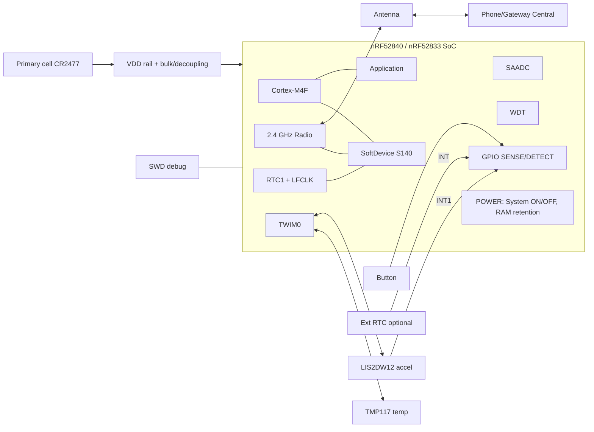

# ULP-BLE Node: Nordic nRF52840 / nRF52833 Ultra-Low-Power BLE Firmware
## Part 1 of 6: Overview, Hardware and Architecture (Sections 1-8)

**Document ID:** ULPBLE-DOC-01 | **Revision:** 0.1 (draft) | **Date:** 2026-10-20

### Legend used in all documents (read this first)

| Tag | Meaning |
|---|---|
| **[TARGET]** | A design goal the firmware/hardware is meant to meet. Not a measurement. |
| **[ASSUMED]** | A value assumed for calculation. Replace with a datasheet or measured value. |
| **[DATASHEET-CHECK]** | Order-of-magnitude value from vendor documentation. Confirm against the exact Product Specification / silicon revision you use. |
| **[VERIFY]** | Must be physically measured or tested on hardware. No result is claimed here. |
| **[EXAMPLE]** | Example part number or value. Confirm availability and suitability. |

**No measured result appears anywhere in this package.** Every results table is blank or marked `[VERIFY]` for you to fill from the bench.

---

## 1. Project Overview and Abstract

**Project name:** nRF52840 / nRF52833 Ultra-Low-Power BLE Firmware (reference product name: *ULP-BLE Node*)

**Abstract.** The ULP-BLE Node is a battery-powered Bluetooth Low Energy peripheral built around the Nordic nRF52840 (primary) and nRF52833 (pin-compatible port target). The firmware is written in Embedded C on the Nordic nRF5 SDK with a Nordic SoftDevice BLE stack. Its central engineering goal is to **minimize energy per unit time** across the full device lifecycle by using two chip-level power regimes:

- **System ON**, the state used while advertising, connected, or sleeping between radio and CPU events. The CPU sleeps via WFE/WFI, the RTC and low-frequency clock stay alive, and selected RAM blocks stay powered.
- **System OFF**, the deepest state, used when the device has nothing to do. Only wake-capable logic stays alive. Wake-up is a reset, so the firmware must **save and restore state** deliberately.

The project covers: wake-source selection and tuning (button, motion interrupt, optional external RTC), retention of state across System OFF (GPREGRET registers, selected RAM sections, flash records), peripheral shutdown discipline (TWIM, SAADC, UARTE, GPIO), BLE parameter tuning (advertising and connection intervals, slave latency, supervision timeout) and measurement methodology (PPK2-based profiling).

A representative application payload (temperature, battery voltage, motion events) is carried over a custom GATT service so that the low-power behaviour can be exercised end to end with a real workload.

## 2. Problem Statement and Objectives

### 2.1 Problem statement
Battery-powered BLE devices (coin-cell or small primary-cell) fail in the field for one dominant reason: **average current is higher than designed**. Typical causes are peripherals left enabled, floating or mis-biased GPIO, an unnecessarily short advertising interval, a high-frequency clock held requested, debug logging left on, and no deep-sleep strategy while the device is idle for hours or days. Existing reference examples often demonstrate a single sleep mode, not a coherent lifecycle (advertise, connect, idle, deep sleep, wake, resume).

### 2.2 Objectives
All numeric goals are **[TARGET]** and must be confirmed by measurement **[VERIFY]**.

| # | Objective | Target |
|---|---|---|
| O1 | Implement and validate System ON low-power operation (advertising, connected idle) | Firmware uses `sd_app_evt_wait()` / `nrf_pwr_mgmt_run()`; no busy-wait loops |
| O2 | Implement and validate System OFF entry and exit | Board-level System OFF current **≤ 2 µA** with motion sensor armed **[TARGET]** |
| O3 | Tune wake-up sources | Button (active-low) and motion interrupt wake the device; spurious wake rate **0 in 24 h soak** **[TARGET]** |
| O4 | Tune peripheral state retention | Config and counters survive System OFF with CRC-validated restore; cold boot defaults on corrupt data |
| O5 | Reliable connected operation at low power | Connected idle average current **≤ 15 µA** at 1 s connection interval, latency 4 **[TARGET]** |
| O6 | Robustness | Watchdog, fault logging and safe recovery; no lock-up in any power state transition |
| O7 | Portability | Single code base builds for nRF52840 and nRF52833 with a board-support layer |
| O8 | Documentation and traceability | Requirements mapped to test cases (Part 3) |

## 3. Features and Applications

### 3.1 Features
- Dual power-mode lifecycle: **ADVERTISING → CONNECTED → System ON idle → System OFF**
- Configurable wake sources (button, accelerometer wake-on-motion, optional external RTC alarm)
- Retained state through System OFF using `GPREGRET`, a `.noinit` RAM section with CRC, and flash persistence (FDS)
- Peripheral power gating: sensor I²C (TWIM) and SAADC enabled only for the duration of a measurement
- DC/DC regulator enabled for radio efficiency (requires the DC/DC inductor on board)
- Custom GATT service: telemetry notify, config read/write, control write, status read
- Adaptive advertising: fast then slow, then timeout into System OFF
- Hardware watchdog, HardFault capture, reset-reason tracking
- Battery voltage measurement via SAADC internal VDD channel (no divider current)
- Build-time switch for an optional FreeRTOS tickless variant (Section 11, Part 2)

### 3.2 Applications
Asset and cold-chain trackers, wearable and personal-safety tags, BLE environmental sensors, smart-lock/door sensors with wake-on-motion, industrial condition-monitoring tags, and any device where "sleeps for days, wakes on event" is the dominant use pattern.

## 4. Hardware Components and BOM

Part numbers are **[EXAMPLE]**. Confirm lifecycle status, package and availability before ordering.

| Ref | Qty | Description | Example part | Notes |
|---|---|---|---|---|
| U1 | 1 | BLE SoC module, nRF52840 | Raytac MDBT50Q family (nRF52840 variant) | Integrates antenna, 32 MHz crystal, matching and DC/DC parts. Verify whether a 32.768 kHz crystal is on-module. |
| U1-alt | 1 | BLE SoC module, nRF52833 | Raytac MDBT50Q family (nRF52833 variant) | Port target; 512 kB flash / 128 kB RAM |
| DK1 | 1 | Dev kit (bring-up) | nRF52840-DK (PCA10056) / nRF52833-DK (PCA10100) | Used before custom PCB |
| U2 | 1 | Digital temperature sensor, I²C | TI TMP117 | Low-power shutdown / one-shot mode **[DATASHEET-CHECK]** |
| U3 | 1 | 3-axis accelerometer with wake-up interrupt | ST LIS2DW12 | Used as motion wake source, INT1 output |
| U4 | 0-1 | External RTC with alarm interrupt (optional) | Micro Crystal RV-3028-C7 | Provides periodic wake from System OFF (nRF52 has no internal RTC wake in System OFF) |
| Y1 | 0-1 | 32.768 kHz crystal | Per module/SoC guidance | Needed for LFXO accuracy and lowest sleep current |
| BT1 | 1 | Primary cell + holder | CR2477 (or CR2450) | Capacity **[ASSUMED]**; check pulse-current capability |
| C1 | 1 | Bulk/pulse reservoir cap, low ESR | 47 µF **[ASSUMED]** | Supports radio TX bursts on a high-internal-resistance coin cell |
| C2-C4 | 3 | Decoupling | 100 nF, 1 µF, 10 µF | Close to VDD pins/module |
| R1, R2 | 2 | I²C pull-ups | 4.7 kΩ **[ASSUMED]** | Tune for bus capacitance and leakage |
| R3 | 1 | Button pull-up (or use internal pull-up) | 1 MΩ external optional | Prefer internal pull-up enabled **only** when needed |
| SW1 | 1 | Tactile switch (wake / user) | Generic | Active low to GND |
| D1 | 1 | Status LED (debug use only) | 0603 LED + series R | Disabled in production low-power profile |
| J1 | 1 | SWD debug connector | Tag-Connect TC2030-NL | VTref, SWDIO, SWDCLK, nRESET, GND |
| TP1 | 1 | Current measurement header / 0 Ω link in series with VBAT | 2-pin header | For PPK2 in ampere mode |
| D2 | 1 | ESD protection on user-exposed pins | Low-capacitance TVS | Capacitance matters if used on button line |

## 5. MCU Selection and Pin Configuration

### 5.1 Selection rationale

| Parameter | nRF52840 (primary) | nRF52833 (port target) |
|---|---|---|
| Core | Arm Cortex-M4F, 64 MHz | Arm Cortex-M4F, 64 MHz |
| Flash / RAM | 1 MB / 256 kB | 512 kB / 128 kB |
| Radio | Bluetooth LE (incl. 2M PHY, Coded PHY, ext. adv.), 2.4 GHz proprietary | Same family capability |
| System OFF wake | GPIO SENSE (DETECT), LPCOMP, NFC field, reset, debug | Same |
| Regulator | DC/DC + LDO | DC/DC + LDO |
| SoftDevice | S140 | S140 (also S113 option) |

**Why nRF52840 as the primary:** the largest RAM and flash headroom for SoftDevice + application + FDS records, and the broadest SoftDevice support. **Why also nRF52833:** lower-cost option with the same peripherals used here; resource budgets (Part 3) are written so the project fits both. Always read the Product Specification for the silicon revision you build against **[DATASHEET-CHECK]**.

### 5.2 Pin assignment (proposed, 52840 DK-compatible where noted)

| Signal | MCU pin | Direction | Function | Low-power handling |
|---|---|---|---|---|
| I²C SDA | P0.26 | Bidir | TWIM0 to TMP117, LIS2DW12 | Peripheral disabled after use; pins to input/disconnect |
| I²C SCL | P0.27 | Out (open-drain style) | TWIM0 | Same |
| BTN | P0.11 | In | User button / System OFF wake (SENSE low) | Internal pull-up |
| ACC_INT1 | P0.28 | In | Motion wake interrupt (SENSE high) | Pull-down (or none if driver is push-pull) |
| TEMP_ALERT | P0.29 | In | TMP117 alert (optional threshold wake) | Input, no pull |
| RTC_INT | P0.30 | In | External RTC alarm (optional) | SENSE low (open-drain output typical) |
| LED | P0.13 | Out | Debug status LED | Driven low / disconnected in production |
| UART TX | P0.06 | Out | Debug/log only (disabled in production) | Pin disconnected when UART off |
| UART RX | P0.08 | In | Debug/log only | Pin disconnected when UART off |
| VBAT sense | internal VDD channel | n/a | SAADC measures VDD directly | No divider, no pin |
| SWDIO / SWDCLK | dedicated | n/a | Programming/debug | |
| nRESET | P0.18 (if enabled as reset) | In | External reset | Pad configuration per hardware design |
| NFC pins | P0.09 / P0.10 | n/a | Reserved. Configure as GPIO only if NFC is unused and the design deliberately does so | Avoid by default |

**Rules:** all unused pins configured as **input with buffer disconnected** (`NRF_GPIO_PIN_INPUT_DISCONNECT`, no pull) to prevent leakage. Verify the pin choices exist on the chosen module castellations **[VERIFY]**.

## 6. Circuit and Connection Description

1. **Power.** BT1 (3 V nominal primary cell) feeds the module VDD directly (the SoC supply range allows direct battery connection **[DATASHEET-CHECK]**). C1 (bulk) and C2-C4 (decoupling) sit at the module supply pins. A series 0 Ω link or 2-pin header (TP1) in the VBAT line allows current measurement with a PPK2.
2. **Regulator.** The DC/DC converter is enabled in firmware (`sd_power_dcdc_mode_set`). This is valid **only** if the DC/DC inductor/capacitor network is fitted. A module with an integrated network satisfies this; a bare-chip design must fit it.
3. **I²C bus.** TMP117 (typically 0x48-0x4B) and LIS2DW12 (0x18 or 0x19) share SDA/SCL with pull-ups R1/R2 to the switched or always-on rail. Sensor supply is shared with VDD in the baseline design. A load-switch variant (GPIO-controlled) is documented as an option for sensors with higher leakage.
4. **Wake inputs.** BTN is active-low (to GND, SENSE low). ACC_INT1 is configured active-high, latched, push-pull (SENSE high). RTC_INT is active-low open-drain (SENSE low). All three are routed to GPIOs usable as System OFF wake pins.
5. **Debug.** SWD via Tag-Connect. A UART is exposed for logging in development builds only.
6. **RF.** Module antenna keep-out respected (Section 17, Part 3).

## 7. System Block Diagram



ASCII fallback:

```
 [CR2477] -> [VDD + caps] -> +---------------- nRF52840/52833 ----------------+
                              | CPU + SoftDevice | Radio | RTC1/LFCLK | WDT   |
 [Button] ------------------> | GPIO SENSE ----> POWER (System ON / OFF)      |
 [LIS2DW12 INT1] -----------> |                                               |
 [RTC INT] (optional) ------> | TWIM0 <---> TMP117, LIS2DW12 | SAADC (VDD)    |
                              +----------------- Radio <-> Antenna <-> Phone -+
```

## 8. Hardware and Software Architecture

### 8.1 Hardware architecture
Single-SoC design. The SoC performs sensing orchestration, BLE, power management and storage. External parts are limited to two sensors, optional RTC, a button and the battery. No external MCU, no external regulator in the baseline.

### 8.2 Software architecture (layered)

```
+-----------------------------------------------------------+
| Application layer   app_main, app_state (FSM), app_cfg    |
+-----------------------------------------------------------+
| Services / Middleware  ble_ulp_svc (GATT), power_mgr,     |
|  wake_mgr, retention, telemetry, diag, protocol (framing) |
+-----------------------------------------------------------+
| Drivers / HAL    drv_tmp117, drv_lis2dw12, drv_vbat,      |
|  hal_gpio_lp, hal_twi, hal_saadc, hal_wdt, hal_flash      |
+-----------------------------------------------------------+
| Nordic SDK / SoftDevice  nrf_sdh, app_timer, nrf_pwr_mgmt,|
|  fds, ble_advertising, ble_conn_params, nrf_ble_gatt, nrfx|
+-----------------------------------------------------------+
| Hardware   nRF52840 / nRF52833 peripherals                |
+-----------------------------------------------------------+
```

### 8.3 Key design decisions

| Decision | Choice | Reason |
|---|---|---|
| Execution model | Event-driven, bare-metal on nRF5 SDK (`app_scheduler` + `nrf_pwr_mgmt_run`) | Lowest overhead; fewer wake events |
| RTOS | Optional FreeRTOS tickless variant | Provided for teams that need tasks; baseline does not require it |
| Periodic timing | `app_timer` on RTC1 (LFCLK) | Runs in System ON sleep at µA level |
| Deep sleep | `sd_power_system_off()` | Required call when SoftDevice is enabled |
| State across System OFF | GPREGRET + CRC-protected retained RAM + FDS | Wake is a reset; RAM is lost unless retained |
| Logging | Compile-time off in production | UART/RTT logging raises current |
| Wake of periodic nature from System OFF | External RTC (optional) | No internal RTC alarm wake in System OFF |

> **Important design fact:** System OFF wake sources on this SoC family are GPIO (SENSE/DETECT), LPCOMP, NFC field, reset and debug interface. The internal RTC does **not** run in System OFF. Therefore a periodic telemetry wake from System OFF requires an external source (the optional RTC U4) or a staying in System ON with long advertising/connection intervals. The firmware supports both strategies via configuration. **[DATASHEET-CHECK]**

*End of Part 1.*
