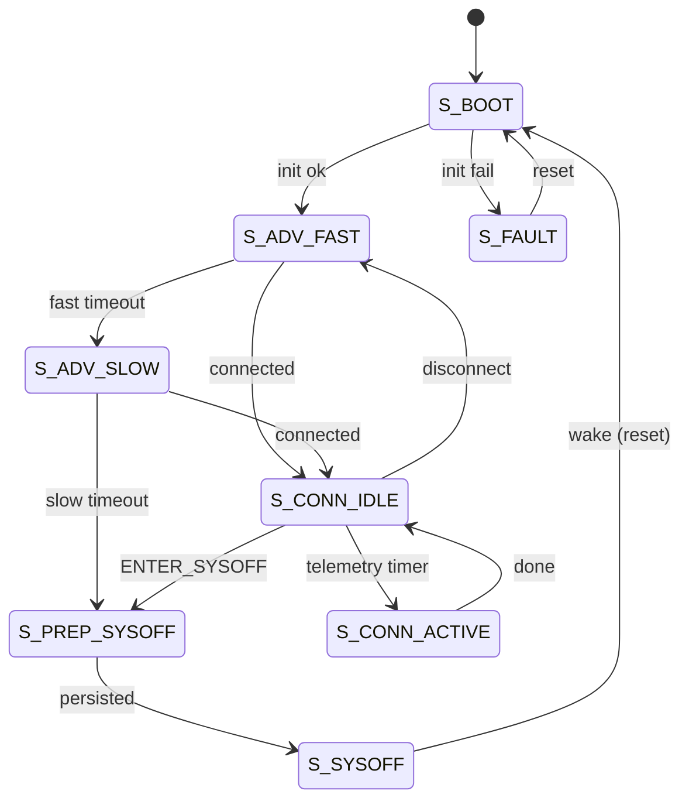
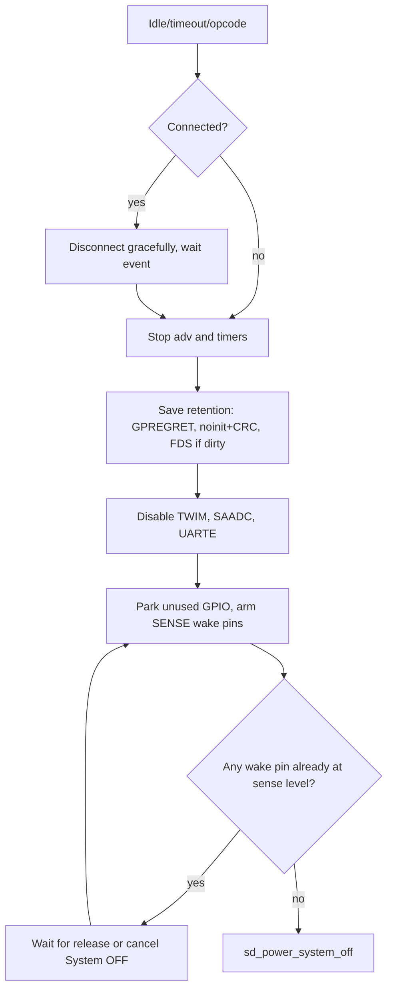
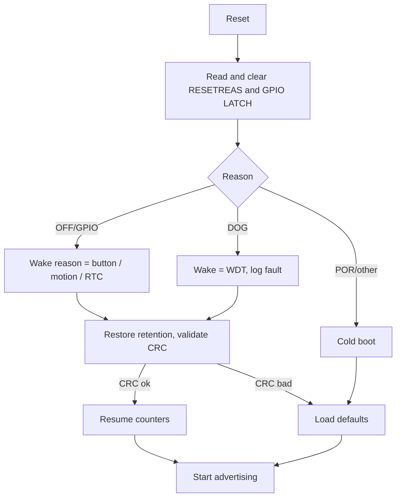

# ULP-BLE Node: Part 2 of 6: Firmware Architecture (Sections 9-15)

**Document ID:** ULPBLE-DOC-02 | **Revision:** 0.1 (draft) | **Date:** 2026-10-20
Legend tags ([TARGET], [ASSUMED], [DATASHEET-CHECK], [VERIFY], [EXAMPLE]) are defined in Part 1. API names follow **nRF5 SDK 17.1.0 + S140 SoftDevice**; confirm exact signatures against the SDK headers you build with **[VERIFY]**.

> Note: the nRF5 SDK is in maintenance mode at Nordic. The architecture below maps directly onto nRF Connect SDK (Zephyr) concepts (see the Developer Guide, Part 5, Section "Migration").

---

## 9. Embedded C Firmware Architecture

### 9.1 Execution model
Event-driven, interrupt-fed, run-to-completion. Interrupts and SoftDevice events post work to `app_scheduler`. The main loop drains the scheduler and then sleeps:

```c
int main(void)
{
    board_early_init();            // GPIO default-lowpower, read RESETREAS
    wake_mgr_capture_reset_reason();// MUST run before SoftDevice enable
    log_init_if_enabled();         // compiled out in production
    timers_init();                 // app_timer on RTC1
    power_mgmt_init();             // nrf_pwr_mgmt_init, DC/DC mode set after SD enable
    ble_stack_init();              // nrf_sdh_enable_request, DC/DC enable
    gap_gatt_services_init();      // GAP params, GATT, conn params, ULP service
    retention_restore();           // CRC-validated restore or defaults
    wdt_init();                    // 10 s timeout [TARGET]
    app_fsm_start();               // chooses BOOT path from wake reason

    for (;;) {
        app_sched_execute();
        nrf_pwr_mgmt_run();        // WFE / sd_app_evt_wait inside; System ON sleep
    }
}
```

### 9.2 Firmware module map

| Module | Responsibility |
|---|---|
| `app_main.c` | Initialization order, main loop |
| `app_fsm.c` | Power/connection state machine (Section 14) |
| `app_cfg.c/h` | Runtime configuration (adv intervals, timeouts, wake mask) with defaults |
| `power_mgr.c` | Policy: idle timers, System OFF entry, peripheral shutdown hooks |
| `wake_mgr.c` | Configure/clear wake sources, decode wake reason |
| `retention.c` | GPREGRET codes, `.noinit` record with CRC-16, FDS persistence |
| `ble_ulp_svc.c` | Custom GATT service (telemetry, config, control, status) |
| `protocol.c` | Frame encode/decode, CRC-16-CCITT |
| `telemetry.c` | Sensor sample orchestration and payload build |
| `diag.c` | Fault log, counters, reset-reason history |
| `drv_tmp117.c`, `drv_lis2dw12.c`, `drv_vbat.c` | Sensor/battery drivers |
| `hal_gpio_lp.c`, `hal_twi.c`, `hal_saadc.c`, `hal_wdt.c` | Thin low-power-aware HAL |

### 9.3 Coding rules
MISRA-C:2012 as a guideline (not claimed compliant); fixed-width types; no dynamic allocation after init; no blocking delays longer than 1 ms outside init; every public function returns `ret_code_t` or a project `status_t`; all ISR-shared data `volatile` with defined ownership.

## 10. Drivers, HAL, Middleware and Application Layers

### 10.1 HAL (hardware abstraction)

| HAL API | Behaviour | Low-power rule |
|---|---|---|
| `hal_gpio_lp_init_all_unused()` | Configure all unused pins as input, buffer disconnected | Run once at boot |
| `hal_gpio_lp_prepare_sysoff()` | Set wake pins with SENSE; park all others | Before System OFF |
| `hal_twi_acquire()/release()` | Enable TWIM, run transfer, disable TWIM | Never leave TWIM enabled when idle |
| `hal_saadc_sample_vdd_mv()` | Init → one-shot sample → uninit | SAADC off between samples |
| `hal_wdt_init()/feed()` | Start nRF WDT, feed from health monitor | Behaviour in sleep set per config **[VERIFY]** |

### 10.2 Device drivers
- **`drv_tmp117`**: one-shot conversion mode, then return to shutdown. Reads the 16-bit temperature register (LSB 0.0078125 °C **[DATASHEET-CHECK]**); converts to centi-degrees (`temp_c_x100`).
- **`drv_lis2dw12`**: configured once for low-power wake-up detection: low-power mode, wake-up threshold and duration set, INT1 routed for wake-up, latched. Provides `lis2dw12_arm_wakeup()` and `lis2dw12_ack_wakeup()` (reading the interrupt source register to release the latch).
- **`drv_vbat`**: SAADC VDD channel, returns millivolts, optional averaging of N samples.

### 10.3 Middleware
- **Nordic SDK components**: `nrf_sdh`, `nrf_sdh_ble`, `ble_advertising`, `ble_conn_params`, `nrf_ble_gatt`, `nrf_ble_qwr`, `app_timer`, `app_scheduler`, `nrf_pwr_mgmt`, `fds`, `nrfx_twim`, `nrfx_saadc`, `nrfx_wdt`.
- **Project middleware**: `protocol`, `retention`, `power_mgr`, `wake_mgr`, `ble_ulp_svc`.

### 10.4 Application layer
`app_fsm` + `telemetry` + `app_cfg`. The application never touches registers directly; it calls HAL/middleware only.

### 10.5 Key code skeletons

**Wake-source arming and System OFF entry**

```c
void power_mgr_enter_system_off(uint8_t wake_mask)
{
    // 1. Persist state
    retention_save_before_sysoff();                    // .noinit + GPREGRET + FDS if dirty

    // 2. Quiesce peripherals
    hal_twi_force_disable();
    hal_saadc_force_uninit();
    log_flush_and_disable();

    // 3. Arm wake sources (SENSE)
    hal_gpio_lp_prepare_sysoff();                      // park all non-wake pins
    if (wake_mask & WAKE_BUTTON)
        nrf_gpio_cfg_sense_input(PIN_BTN, NRF_GPIO_PIN_PULLUP,
                                 NRF_GPIO_PIN_SENSE_LOW);
    if (wake_mask & WAKE_MOTION)
        nrf_gpio_cfg_sense_input(PIN_ACC_INT1, NRF_GPIO_PIN_PULLDOWN,
                                 NRF_GPIO_PIN_SENSE_HIGH);
    if (wake_mask & WAKE_EXT_RTC)
        nrf_gpio_cfg_sense_input(PIN_RTC_INT, NRF_GPIO_PIN_NOPULL,
                                 NRF_GPIO_PIN_SENSE_LOW);

    // 4. Optional: retain a RAM section (see Section 16 in Part 3)
    // sd_power_ram_power_set(...)  [VERIFY block/section mapping]

    // 5. Enter System OFF. Wake = reset. Does not return on real hardware.
    uint32_t err = sd_power_system_off();
    APP_ERROR_CHECK(err);
    for (;;) { __WFE(); }                              // fallback if emulated System OFF under debugger
}
```

**Wake-reason decode (runs at boot, before SoftDevice is enabled)**

```c
typedef enum { WAKE_NONE, WAKE_POR, WAKE_BUTTON_EVT, WAKE_MOTION_EVT,
               WAKE_RTC_EVT, WAKE_WDT, WAKE_SOFT, WAKE_FAULT } wake_reason_t;

wake_reason_t wake_mgr_capture_reset_reason(void)
{
    uint32_t r = NRF_POWER->RESETREAS;
    NRF_POWER->RESETREAS = 0xFFFFFFFFu;     // clear
    if (r & POWER_RESETREAS_OFF_Msk) {      // woke from System OFF via GPIO DETECT
        uint32_t latch = NRF_P0->LATCH;     // which pin(s) triggered
        NRF_P0->LATCH = latch;              // clear latches
        if (latch & (1u << PIN_BTN))      return WAKE_BUTTON_EVT;
        if (latch & (1u << PIN_ACC_INT1)) return WAKE_MOTION_EVT;
        if (latch & (1u << PIN_RTC_INT))  return WAKE_RTC_EVT;
        return WAKE_NONE;
    }
    if (r & POWER_RESETREAS_DOG_Msk)       return WAKE_WDT;
    if (r & POWER_RESETREAS_SREQ_Msk)      return WAKE_SOFT;
    if (r & POWER_RESETREAS_LOCKUP_Msk)    return WAKE_FAULT;
    return WAKE_POR;
}
```

(Pin latch decoding applies to GPIO port 0. Pins on port 1 use `NRF_P1`. Register names to be confirmed against your CMSIS headers **[VERIFY]**.)

**Enabling DC/DC and low-power mode after the SoftDevice is enabled**

```c
APP_ERROR_CHECK(sd_power_dcdc_mode_set(NRF_POWER_DCDC_ENABLE));
APP_ERROR_CHECK(sd_power_mode_set(NRF_POWER_MODE_LOWPWR));
```

## 11. FreeRTOS Tasks / RTOS Design (optional variant)

The baseline is bare-metal event-driven. For teams that need task isolation, a **FreeRTOS tickless** variant (`-DULP_USE_FREERTOS=1`) is provided as a design.

| Task | Priority (higher = more urgent) | Stack (words) **[ASSUMED]** | Role |
|---|---|---|---|
| `tskBLE` (SoftDevice handler task via `nrf_sdh_freertos`) | 3 | 256 | BLE event dispatch |
| `tskSensor` | 2 | 256 | Sample sensors on timer notification, build telemetry |
| `tskPower` | 2 | 192 | Idle policy, System OFF decisions |
| `tskHousekeeping` | 1 | 192 | WDT health aggregation, diagnostics, FDS GC |
| Idle hook | 0 | n/a | `vApplicationIdleHook` empty; relies on tickless sleep |

**Inter-task communication:** task notifications for events; one queue (`q_telemetry`, depth 4) from `tskSensor` to `tskBLE`; one mutex for I²C bus ownership (`mtx_i2c`).

**Tickless idle:** `configUSE_TICKLESS_IDLE = 2` with the Nordic port that uses RTC1 for the tick and calls `sd_app_evt_wait()` when the SoftDevice is enabled. **[VERIFY against SDK port file]**

**Interrupt priority constraint:** the SoftDevice reserves interrupt priorities 0, 1 and 4; application ISRs that call FreeRTOS `FromISR` APIs must run at priorities allowed by `configMAX_SYSCALL_INTERRUPT_PRIORITY` and not collide with reserved SoftDevice levels. **[VERIFY]**

**Health monitor:** each task sets its bit in a `health_mask` at least once per period; `tskHousekeeping` feeds the WDT only if all expected bits are set (Section 15).

**Trade-off note:** each task wake costs energy. The Sensor and Power tasks are timer-notified and **never poll**. The baseline remains recommended when the application is small.

## 12. Communication Protocols

| Interface | Use | Notes |
|---|---|---|
| **BLE (GAP/GATT, SoftDevice S140)** | Advertising, connection, telemetry/config | LE 1M PHY default; Coded PHY optional for range at higher energy cost |
| **I²C (TWIM0)** | TMP117, LIS2DW12 (and optional RTC) | 100/400 kHz **[ASSUMED]**; enable only during transfer |
| **UART (UARTE0)** | Development logging only | Off in production |
| **SWD** | Programming/debug | |
| SPI, CAN | Not used in this project | Documented as not applicable |

### 12.1 BLE parameters (initial values **[ASSUMED]**, tune with measurement)

| Parameter | Fast adv | Slow adv | Connected |
|---|---|---|---|
| Advertising interval | 100 ms for 30 s | 1000 ms for up to 120 s | n/a |
| Connection interval | n/a | n/a | 500 ms preferred (min 200, max 1000) |
| Slave latency | n/a | n/a | 4 |
| Supervision timeout | n/a | n/a | 6 s |
| TX power | 0 dBm default; configurable | same | same |

Constraint check: supervision timeout must satisfy `timeout > (1 + latency) × interval × 2`. With 500 ms and latency 4: 5 × 500 × 2 = 5000 ms < 6000 ms. ✔

### 12.2 GATT service layout

| Attribute | UUID (placeholder) | Properties | Content |
|---|---|---|---|
| ULP Service | `<base>-0001` | n/a | Primary service |
| Telemetry | `<base>-0002` | Notify | 20-byte frame (Section 13) |
| Config | `<base>-0003` | Read, Write | Adv intervals, telemetry period, idle timeout, wake mask |
| Control | `<base>-0004` | Write (no response) | Opcodes (Section 13.3) |
| Status | `<base>-0005` | Read | Power state, reset/wake reason, counters, version |

Replace `<base>` with a project-specific vendor-specific 128-bit UUID generated for the product. Do not reuse placeholder UUIDs in production. **[VERIFY]**

## 13. Data / Communication Frame Format

All multi-byte fields are **little-endian**. CRC is **CRC-16/CCITT-FALSE** (poly 0x1021, init 0xFFFF) over all bytes before the CRC field.

### 13.1 Telemetry frame (Notify, exactly 20 bytes so it fits the default 23-byte ATT MTU)

| Offset | Size | Field | Description |
|---|---|---|---|
| 0 | 1 | `ver_type` | High nibble = protocol version (1), low nibble = message type (0x1 telemetry) |
| 1 | 1 | `seq` | Rolling sequence counter |
| 2 | 1 | `len` | Payload length (15) |
| 3 | 2 | `temp_c_x100` | int16, temperature × 100 °C |
| 5 | 2 | `vbat_mV` | uint16 |
| 7 | 1 | `pwr_state` | 0 ADV_FAST, 1 ADV_SLOW, 2 CONN_IDLE, 3 CONN_ACTIVE |
| 8 | 1 | `wake_reason` | `wake_reason_t` of the last boot |
| 9 | 1 | `flags` | b0 low-battery, b1 sensor-fault, b2 retention-restored, b3 motion-since-last |
| 10 | 2 | `motion_cnt` | uint16 motion events since boot (retained) |
| 12 | 2 | `sysoff_cnt` | uint16 System OFF entries (retained) |
| 14 | 4 | `uptime_s` | uint32 seconds since last cold boot (retained base) |
| 18 | 2 | `crc16` | CRC over bytes 0-17 |

Total = 3 header + 15 payload + 2 CRC = **20 bytes**.

### 13.2 Config characteristic (Read/Write)

| Offset | Size | Field | Range |
|---|---|---|---|
| 0 | 1 | `ver` | 1 |
| 1 | 2 | `adv_fast_ms` | 20-1000 |
| 3 | 2 | `adv_slow_ms` | 100-10240 |
| 5 | 2 | `adv_fast_dur_s` | 1-600 |
| 7 | 2 | `idle_to_sysoff_s` | 10-65535 (0 = never) |
| 9 | 2 | `telem_period_s` | 1-3600 |
| 11 | 1 | `wake_mask` | b0 button, b1 motion, b2 ext RTC |
| 12 | 1 | `tx_power_dbm` | per supported levels |
| 13 | 2 | `crc16` | |

### 13.3 Control opcodes (Write without response)

| Opcode | Name | Params | Effect |
|---|---|---|---|
| 0x01 | `ENTER_SYSOFF` | wake_mask (1 B) | Save, arm wake sources, System OFF |
| 0x02 | `SET_ADV` | fast_ms (2 B), slow_ms (2 B) | Update advertising intervals |
| 0x03 | `SET_TELEM` | period_s (2 B) | Change telemetry period |
| 0x04 | `GET_STATUS` | none | Triggers a Status update |
| 0x05 | `CLEAR_COUNTERS` | none | Reset retained counters |
| 0x06 | `SOFT_RESET` | magic 0xA55A (2 B) | System reset |

Control frame: `[opcode:1][plen:1][params:plen][crc16:2]`. Invalid frames are ignored and counted in `diag.bad_frames`. **Security note:** for production, the Control characteristic should require an encrypted, bonded link (LE Secure Connections). **[TARGET]**

## 14. Algorithms, Flowcharts and State Machine

### 14.1 Power state machine

| State | Chip regime | Description |
|---|---|---|
| `S_BOOT` | System ON | Init, decode wake reason, restore retention |
| `S_ADV_FAST` | System ON | Fast advertising window |
| `S_ADV_SLOW` | System ON | Slow advertising window |
| `S_CONN_IDLE` | System ON | Connected, no activity, CPU asleep, slave latency in effect |
| `S_CONN_ACTIVE` | System ON | Sampling/notifying |
| `S_PREP_SYSOFF` | System ON | Persist state, quiesce peripherals, arm wake |
| `S_SYSOFF` | **System OFF** | Lowest power. Wake = reset into `S_BOOT` |
| `S_FAULT` | System ON | Fault captured, controlled reset |

| From | Event | To | Action |
|---|---|---|---|
| `S_BOOT` | Init OK | `S_ADV_FAST` | Start advertising |
| `S_BOOT` | Wake = motion/button | `S_ADV_FAST` | Include event flag in adv data |
| `S_ADV_FAST` | Connected | `S_CONN_IDLE` | Negotiate conn params |
| `S_ADV_FAST` | Fast timeout | `S_ADV_SLOW` | Restart adv at slow interval |
| `S_ADV_SLOW` | Connected | `S_CONN_IDLE` | |
| `S_ADV_SLOW` | Slow timeout | `S_PREP_SYSOFF` | |
| `S_CONN_IDLE` | Telemetry timer | `S_CONN_ACTIVE` | Sample, notify |
| `S_CONN_ACTIVE` | Done | `S_CONN_IDLE` | Disable TWIM/SAADC |
| `S_CONN_*` | Disconnect | `S_ADV_FAST` | Restart advertising |
| `S_CONN_IDLE` | `ENTER_SYSOFF` opcode | `S_PREP_SYSOFF` | Disconnect gracefully first |
| any | Low battery critical | `S_PREP_SYSOFF` | Wake mask = button only |
| any | Fault | `S_FAULT` | Log, reset |
| `S_PREP_SYSOFF` | Persist OK | `S_SYSOFF` | `sd_power_system_off()` |



### 14.2 Flowchart: System OFF entry



The check at step H is essential: if a SENSE pin is **already** at its sense level when System OFF is entered, the device can wake immediately (a wake loop).

### 14.3 Flowchart: Boot and wake decode



### 14.4 Algorithms
- **Adaptive advertising:** fast (energy-expensive, quick discovery) for a bounded window, then slow, then System OFF. Durations are runtime-configurable.
- **Battery policy:** measure VDD each telemetry period using a moving average of N=4 samples. Thresholds **[ASSUMED]**: warning at 2.4 V, critical at 2.2 V (confirm against the cell discharge curve and the minimum SoC supply voltage **[DATASHEET-CHECK]**). The measurement should be taken after a radio event settles, to avoid sag-induced false low readings; document the sample timing.
- **Motion debounce:** after a motion wake, ignore additional INT1 events for `T_hold` (default 2 s **[ASSUMED]**) to prevent connection churn.
- **Retention validity:** `retention_t` includes a magic number, struct version, payload and CRC-16. Restore only if all three validate.

## 15. Error Handling, Diagnostics and Watchdog

### 15.1 Error handling strategy

| Layer | Mechanism |
|---|---|
| SDK calls | `APP_ERROR_CHECK` → `app_error_fault_handler` → record fault → controlled reset |
| Drivers | Return `status_t`; retry I²C up to 3 times with bus-recovery (9 clock pulses) |
| Protocol | CRC fail or length mismatch → drop frame, count |
| Sensors | Sensor fault flag set in telemetry; last-good value held, not fabricated |
| Power | Refuse System OFF if a wake pin is already asserted; refuse if retention save failed (fall back to retaining nothing, boot to defaults) |

### 15.2 Fault capture
- **HardFault handler** stores stacked R0-R3, R12, LR, PC, xPSR into a `.noinit` fault record (with CRC) and triggers a reset. After reboot, the fault record is reported in the Status characteristic and logged.
- **SoftDevice asserts** go through `app_error_fault_handler` with the `id` and `pc`.
- **Fault codes (project):** `F_I2C_TIMEOUT`, `F_SENSOR_ID`, `F_RET_CRC`, `F_ADV_START`, `F_ASSERT`, `F_WDT`, `F_HARDFAULT`.

### 15.3 Watchdog design
- nRF WDT configured with timeout **10 s [TARGET]**, reload request 0; behaviour in sleep set to run (counting) while the CPU sleeps in System ON.
- Fed only by the health monitor (not from an arbitrary ISR), so a hung main flow cannot be masked.
- Health bits: `H_MAIN` (scheduler executed), `H_BLE` (SoftDevice event seen or advertising active), `H_TIMER` (app_timer tick). Feed happens in an `app_timer` callback every 4 s **[ASSUMED]** if all bits set within the last window.
- WDT cannot be stopped once started. Verify its current contribution to sleep current on the bench **[VERIFY]**, and verify its behaviour across System OFF and under the debugger **[VERIFY]**.

### 15.4 Diagnostics
Counters (retained): boots, WDT resets, hardfaults, bad frames, I²C errors, retention restores/failures, System OFF entries, wake counts per source. Exposed via Status characteristic and development log.

*End of Part 2.*
